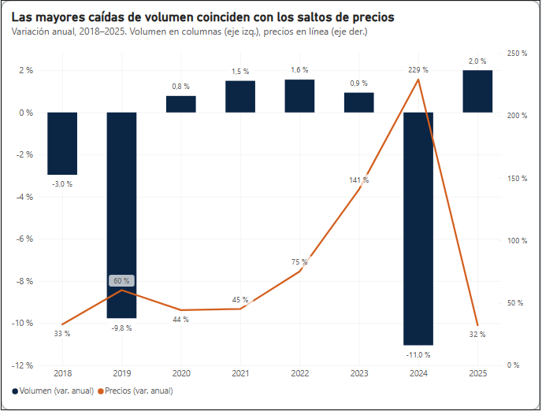
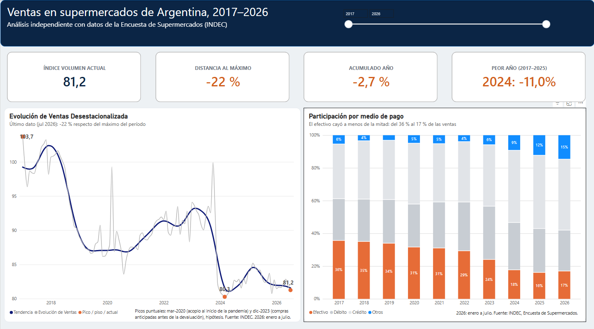
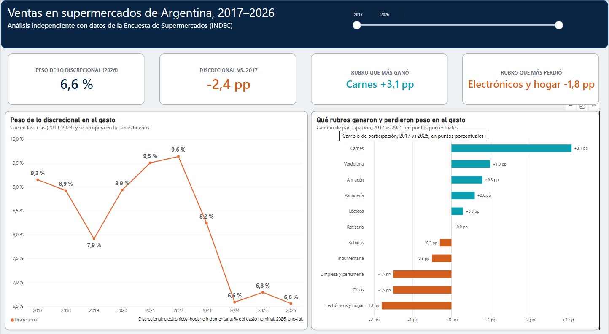
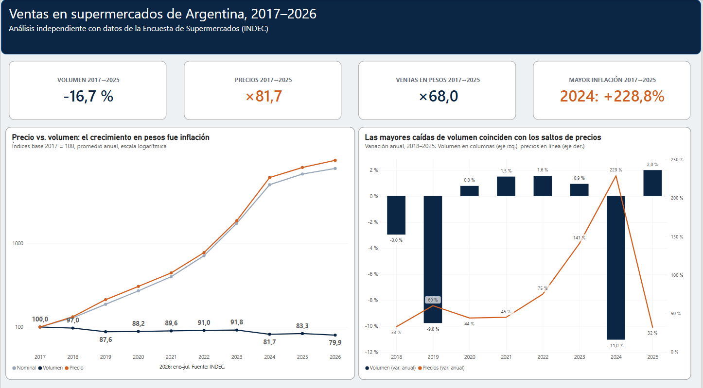

# Ventas en supermercados de Argentina (2017–2026) · Python · PostgreSQL · Power BI

*[Read in English](README.md)*

Análisis de punta a punta de la **Encuesta de Supermercados del INDEC** (serie mensual, enero 2017 – julio 2026). El Excel original se limpia con **pandas**, se carga en un modelo estrella en **PostgreSQL** y se consulta con **SQL** para responder cuatro preguntas de negocio. Los resultados se presentan en un dashboard de **Power BI**.

El desafío central es la inflación. Las ventas en pesos se multiplicaron por 68 en el período, así que las cifras nominales casi no dicen nada por sí solas. El análisis usa el índice de precios implícitos de la propia encuesta para separar el **volumen real** del **precio**.

## Preguntas de negocio
1. ¿Cuánto crecieron o cayeron **realmente** las ventas (a precios constantes) y dónde estamos frente al pico?
2. ¿Cuánto del crecimiento nominal es **precio** y cuánto es **volumen**?
3. ¿Cómo cambió la **canasta**: básicos vs. discrecionales?
4. ¿Cómo **pagan** los clientes: efectivo, débito, crédito o billeteras?

Métricas, supuestos y limitaciones: [`docs/preguntas_negocio.md`](docs/preguntas_negocio.md)

## Hallazgos principales

### 1. Las ventas reales están 22 % debajo del pico de 2017


En julio de 2026, el índice de volumen desestacionalizado está en 81,2 (2017 = 100). Eso es **21,7 % por debajo del máximo de la serie** (enero 2017) y apenas 1 % arriba del mínimo de marzo 2024. La caída se dio en dos escalones: 2018–2019 (−12 % acumulado) y 2024 (−11 % en un solo año), que borró la recuperación lenta de 2020–2023. Tras un rebote en 2025 (+2 %), enero–julio de 2026 vuelve a caer (−2,7 % interanual).

> *Hipótesis:* los dos escalones coinciden con las devaluaciones y los picos inflacionarios de 2018–2019 y de fines de 2023–2024.

### 2. Todo el crecimiento en pesos fue inflación


Entre 2017 y 2025, las ventas en pesos se multiplicaron por **68** y los precios del supermercado por **82**, así que **el volumen cayó 17 %**. Las dos mayores caídas anuales de volumen coinciden con los dos saltos de precios: **2019** (precios +60 %, volumen −9,8 %) y **2024** (precios +229 %, volumen −11,0 %).

**2023 fue la excepción:** los precios subieron 141 % y el volumen se mantuvo estable (+0,9 %).

> *Hipótesis:* compras anticipadas ante la expectativa de devaluación, en línea con el pico de diciembre de 2023 en la serie mensual.
>
> *Nota:* el índice de precios es el deflactor implícito de las ventas en supermercados, no el IPC oficial.

### 3. La canasta se volcó a lo básico en las crisis


Los rubros discrecionales (electrónica, hogar e indumentaria) pasaron del **9,2 % del gasto en 2017 al 6,6 % en 2026**. Cayeron en 2019 y 2024, los mismos años de las bajas de volumen, se recuperaron en parte en 2020–2022 y desde 2024 no se recuperaron. Dentro de los básicos, **carnes ganó 3,1 puntos** de participación (9,7 % → 12,8 % en 2025).

> *Limitación:* son participaciones en el gasto nominal, así que parte del cambio puede deberse a precios relativos y no a cantidades.

### 4. El efectivo cayó a menos de la mitad


El efectivo pasó del **35,5 % de las ventas en 2017 al 16,8 % en 2026** (−18,7 pp), con la caída más fuerte en 2024. El crédito se consolidó como el principal medio de pago (43 %), y "otros medios" (billeteras virtuales y QR) casi se triplicó desde 2023, hasta llegar al 15 %.

> *Hipótesis:* la financiación en cuotas en un contexto de alta inflación y la adopción de pagos digitales. *(2026: enero a julio.)*

## Dashboard de Power BI
Tres páginas sobre el mismo modelo de PostgreSQL. El proyecto se versiona en formato **PBIP**: el modelo semántico (TMDL) y el reporte (JSON) son texto plano y se pueden comparar en git.

| Evolución y medios de pago | Mix de canasta | Precio vs. volumen |
|---|---|---|
|  |  |  |

Lo más destacado en DAX:
- Límites de años dinámicos (primer año y último año completo), compartidos entre medidas.
- Tablas virtuales con `ADDCOLUMNS` + `TOPN` para "peor año" y "rubro que más ganó/perdió".
- Ventas deflactadas con `SUMX`.
- Gráfico combinado con eje secundario para la variación anual de precio y volumen.

## Pipeline
```
INDEC (.xlsx) ──► src/download.py ──► data/raw/
                                          │
              src/transform.py  (pandas: encabezados multinivel, ancho → largo,
                                 secreto estadístico, validaciones)
                                          ▼
                                 data/processed/*.csv
                                          │
              src/load_postgres.py  (CSV → esquema stg → modelo estrella vía sql/01_modelo.sql)
                                          ▼
                        PostgreSQL ──► sql/queries/ (una consulta por pregunta)
                                   └─► Power BI (PBIP)
```

**Modelo de datos:** esquema constelación con cuatro tablas de hechos de distinta granularidad (índices, ventas por canal, por medio de pago y por categoría × jurisdicción). Comparten una dimensión de fechas continua y las dimensiones de jurisdicción y categoría. La carga corre en una sola transacción y es idempotente.

**Técnicas SQL:** CTE, funciones de ventana (`LAG`, `FIRST_VALUE`, `SUM() OVER (PARTITION BY …)`) y agregación anual de índices mensuales.

## Estructura del repo
```
├── data/
│   ├── raw/                 # Excel original del INDEC (sin modificar)
│   └── processed/           # CSV en formato tidy
├── docs/                    # fuente de datos, preguntas de negocio
├── src/                     # download.py · transform.py · load_postgres.py
├── sql/
│   ├── 01_modelo.sql        # modelo estrella (stg → super), lo ejecuta load_postgres.py
│   └── queries/             # q1–q4, una por pregunta de negocio
├── reports/
│   ├── figures/             # gráficos de este README
│   └── dashboard/           # capturas de Power BI
├── powerbi/                 # proyecto PBIP (Indec.pbip) + tema
└── docker-compose.yml       # PostgreSQL local opcional
```

## Cómo reproducirlo
```bash
python -m venv .venv
source .venv/bin/activate          # Windows: .venv\Scripts\activate
pip install -r requirements.txt

cp .env.example .env               # completar la conexión a PostgreSQL
docker compose up -d               # opcional: PostgreSQL local en lugar de uno en la nube

python src/download.py             # Excel del INDEC → data/raw/
python src/transform.py            # Excel → data/processed/*.csv
python src/load_postgres.py        # CSV → PostgreSQL (staging + modelo estrella)
```
Después abrí `powerbi/Indec.pbip` en Power BI Desktop y apuntá el origen de datos a tu base.

## Fuente
INDEC, *Encuesta de Supermercados*. Ver [`docs/fuente_datos.md`](docs/fuente_datos.md). Es un análisis independiente, sin relación con el INDEC.

## Próximos pasos
- Provincias: crecimiento real por jurisdicción, deflactado con el índice de precios nacional.
- Participación del canal online después de 2020.
- Actualización mensual automática cuando el INDEC publique datos nuevos.

---
**Autor:** Javier Jandula · Senior BI Engineer → Data Analyst
