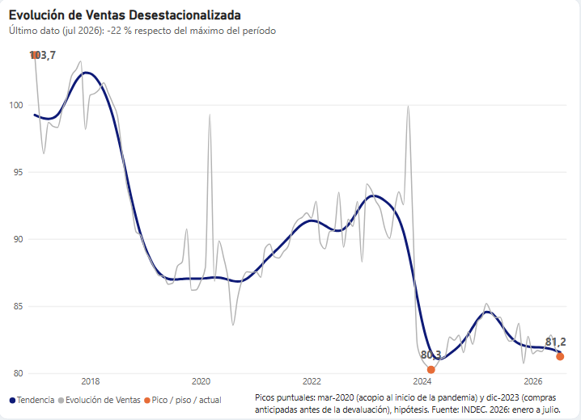
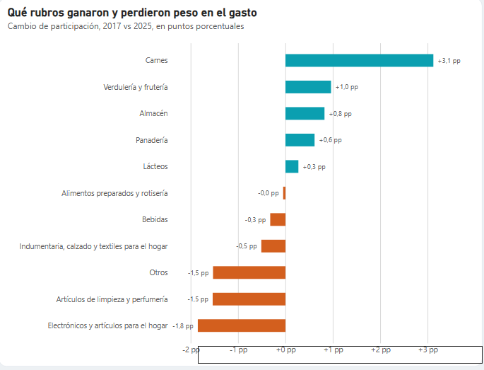
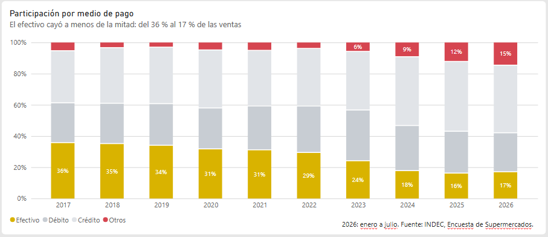

# Ventas en supermercados de Argentina (2017–2026) · Análisis con Python + SQL

> 🚧 Proyecto en construcción. / *Work in progress — English summary below.*

Análisis de la **Encuesta de Supermercados del INDEC** (serie mensual, enero 2017 – julio 2026): limpieza de datos con **pandas**, modelo y consultas en **PostgreSQL**, visualizaciones en **matplotlib/seaborn** y dashboard en **Power BI**.

## Preguntas de negocio
1. ¿Cuánto crecieron o cayeron **realmente** las ventas (a precios constantes) y dónde estamos frente al pico?
2. ¿Cuánto del crecimiento nominal es **precio** y cuánto es **volumen**?
3. ¿Cómo cambió la **canasta**: básicos vs. discrecionales?
4. ¿Cómo **pagan** los clientes: efectivo vs. débito, crédito y billeteras?
5. ¿Qué **provincias** ganan y cuáles pierden en términos reales?

Detalle, métricas y supuestos: [`docs/preguntas_negocio.md`](docs/preguntas_negocio.md)

## Hallazgos principales
### 1. Las ventas reales están 22 % debajo de 2017


En julio de 2026, el volumen vendido en supermercados (serie desestacionalizada) está 21,7 % por debajo del máximo de la serie (enero 2017) y apenas 1 % arriba del mínimo de marzo 2024. La caída se dio en dos escalones: 2018–2019 (−12 % acumulado) y 2024 (−11 % en un solo año), que borró la recuperación lenta de 2020–2023. Tras un rebote en 2025 (+2 %), los primeros siete meses de 2026 vuelven a caer (−2,7 % interanual).
Contexto, como hipótesis: los dos escalones coinciden con las devaluaciones y picos inflacionarios de 2018–2019 y de fines de 2023–2024.

### 2. Las ventas en pesos se multiplicaron por 68 entre 2017 y 2025, pero los precios lo hicieron por 82: en volumen se vende un 17 % menos. Todo el crecimiento nominal fue inflación. El golpe más fuerte fue en 2024, cuando los precios subieron 229 % y el volumen cayó 11 %.

### 3. La canasta se volcó a lo básico en las crisis


Los rubros discrecionales (electrónica, hogar e indumentaria) pasaron del 9,1 % del gasto en 2017 al 6,5 % en 2026, con caídas en 2019 y 2024 que coinciden con las bajas del volumen de ventas, y una recuperación parcial en 2020–2022. Desde 2024 no se recuperaron. Dentro de los básicos, carnes ganó 3 puntos de participación (9,7 % → 12,8 % en 2025). Limitación: son participaciones en el gasto nominal; parte del cambio puede deberse a precios relativos y no a cantidades.
> *Limitación:* son participaciones en el gasto nominal; parte del cambio puede deberse a precios relativos.

### 4. El efectivo cayó a menos de la mitad


El efectivo pasó de 35,5 % de las ventas en 2017 a 16,8 % en 2026 (−18,7 pp), con la caída más fuerte en 2024. El crédito se consolidó como el principal medio de pago (43 %) y "otros medios", que incluye billeteras virtuales y QR, casi se triplicó desde 2023 hasta llegar al 15 %. Hipótesis: la financiación en cuotas en un contexto de alta inflación y la adopción de pagos digitales. (2026: enero a julio.)

5. 


## Pipeline
```
INDEC (.xlsx) ──► src/download.py ──► data/raw/
                                          │
                   src/transform.py (pandas: encabezados multinivel, ancho→largo,
                                     secreto estadístico, deflactor)
                                          ▼
                                  data/processed/*.csv ──► PostgreSQL (sql/) ──► Power BI
                                          │
                                  notebooks/ ──► reports/figures/
```

## Estructura del repo
```
├── data/
│   ├── raw/                 # Excel original del INDEC (sin modificar)
│   └── processed/           # CSV tidy listos para SQL / Power BI
├── docs/                    # fuente de datos, preguntas de negocio, diccionario
├── notebooks/               # 01_exploracion · 02_limpieza · 03_analisis
├── src/                     # download.py · transform.py · load_postgres.py
├── sql/
│   ├── 01_modelo.sql        # modelo estrella (stg → super), lo ejecuta load_postgres.py
│   └── queries/             # una consulta por pregunta de negocio
├── reports/figures/         # PNG usados en este README
└── powerbi/                 # .pbix + capturas del dashboard
```

## Cómo reproducirlo
```bash
python -m venv .venv && .venv\Scripts\activate      # Windows
pip install -r requirements.txt
python src/transform.py        # Excel INDEC → data/processed/*.csv
python src/load_postgres.py    # CSV → PostgreSQL (staging + modelo estrella), conexión en .env```

## Fuente
INDEC, Encuesta de Supermercados. Ver [`docs/fuente_datos.md`](docs/fuente_datos.md).

---
### English summary
Analysis of Argentina's official supermarket sales survey (INDEC, monthly, 2017–2026). Python (pandas) for cleaning multi-level Excel headers and reshaping wide→long, PostgreSQL for the data model and business queries, matplotlib for charts, and a Power BI dashboard. Sales are deflated with the survey's implicit price index to separate real volume from inflation.

**Autor:** Javier · Senior BI Engineer → Data Analyst
